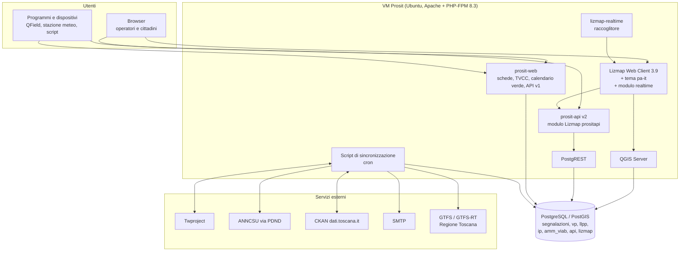

# Prosit

**Prosit** (PRO-SIT) è il Sistema Informativo Territoriale del Comune di Montelupo Fiorentino:
segnalazioni e ticket, verde pubblico, illuminazione, videosorveglianza, mobilità e open data,
consultati e modificati tramite mappe web.

Prosit **non è un unico programma**: è un insieme di componenti open source di terze parti
(PostgreSQL/PostGIS, QGIS Server, Lizmap, PostgREST) e di componenti sviluppati dal Comune,
ognuno nel proprio repository. Questo repository è il **punto di raccolta**: dice di cosa è
fatto Prosit, come i pezzi si collegano e quali versioni funzionano insieme.

> Tutti i repository che fanno parte di Prosit hanno il topic **`prosit`**:
> [elenco aggiornato su GitHub](https://github.com/search?q=org%3AComuneMontelupoFiorentino+topic%3Aprosit&type=repositories)

## Architettura



## Componenti

### Sviluppati dal Comune

| Componente | Cosa fa | Repository | Licenza |
|---|---|---|---|
| prosit-api | API v2: modulo Lizmap `prositapi` + PostgREST, permessi dai gruppi Lizmap, OpenAPI | *in pubblicazione* | — |
| prosit-web | schede dei popup, registro TVCC, calendario verde, report ticket, open data, API v1 e hook (meteo, QField, sopralluoghi), JS dei progetti Lizmap | *in pubblicazione* | da definire |
| prosit-monitor | controllo degli script e di Lizmap, riquadro nell'Amministrazione di Lizmap, pulizia dei log | [prosit-monitor](https://github.com/ComuneMontelupoFiorentino/prosit-monitor) | da definire |
| lizmap-realtime | livelli in tempo reale in Lizmap (bus, sensori, meteo) | [lizmap-realtime](https://github.com/ComuneMontelupoFiorentino/lizmap-realtime) | MPL-2.0 |
| lizmap-tema-pa-it | tema Lizmap in stile Bootstrap Italia | [lizmap-tema-pa-it](https://github.com/ComuneMontelupoFiorentino/lizmap-tema-pa-it) | da definire |
| TWPROJECT-PostgreSQL-API-sync-pg2twprj | ticket di Prosit ↔ ToDo di Twproject (stati, commenti, allegati) | [repository](https://github.com/ComuneMontelupoFiorentino/TWPROJECT-PostgreSQL-API-sync-pg2twprj) | EUPL-1.2 |
| ANNCSU-PostgreSQL-PDND-sync | invio di coordinate, civici e odonimi all'ANNCSU tramite PDND | [repository](https://github.com/ComuneMontelupoFiorentino/ANNCSU-PostgreSQL-PDND-sync) | EUPL-1.2 |
| CKAN-API-sync-sit2ckan | pubblicazione pianificata degli open data da PostgreSQL su CKAN (v2, CKAN Scheduler) | [repository](https://github.com/ComuneMontelupoFiorentino/CKAN-API-sync-sit2ckan) | da definire |
| MAIL-SMTP-PostgreSQL__sender | invio delle mail accodate in una tabella PostgreSQL | [repository](https://github.com/ComuneMontelupoFiorentino/MAIL-SMTP-PostgreSQL__sender) | da definire |
| GTFS-PostgreSQL-upsert_gtfs2sit | orari del trasporto pubblico (GTFS) in PostgreSQL per i popup delle paline | [repository](https://github.com/ComuneMontelupoFiorentino/GTFS-PostgreSQL-upsert_gtfs2sit) | da definire |
| IMAP-extract-body-mail2pg | lettura delle caselle mail (IMAP) verso PostgreSQL | *in pubblicazione* | — |
| REKLA-notify__scheduler | promemoria e report di Rekla | *in pubblicazione* | — |
| EXECUTE-schedulation-manager__scheduler | pianificatore delle attività su database | *in pubblicazione* | — |
| UPSERT-sync-db2pgsql__trigger | sincronizzazione del censimento verso PostgreSQL | *in pubblicazione* | — |
| Lizmap-PostgreSQL-sync-sqlite2pg | utenti di Lizmap verso PostgreSQL (da spegnere dopo la migrazione degli utenti) | *in pubblicazione* | — |
| TRANSFER-DB-compressed__pg2zip | copia e ripristino compressi dei database | *in pubblicazione* | — |
| Strumenti di esercizio | aggiornamento sicuro di Lizmap (`aggiorna_lizmap.sh`), script JS per Lizmap | *in pubblicazione* | — |

### Di terze parti

| Componente | Versione in uso | Ruolo |
|---|---|---|
| PostgreSQL + PostGIS | ≥ 16 | tutti i dati; `postgres_fdw` per il database `api` |
| QGIS Server + plugin Lizmap server | — | rendering delle mappe, WMS/WFS |
| [Lizmap Web Client](https://github.com/3liz/lizmap-web-client) | 3.9.12 | portale delle mappe, utenti e gruppi |
| [PostgREST](https://github.com/PostgREST/postgrest) | 16.5 | REST sopra il database `api`; binario ufficiale `linux-static-x86-64` in `/usr/local/bin/prosit/postgrest-16.5/`, scaricato dai rilasci di PostgREST (non è in questi repository) |
| [firebase/php-jwt](https://github.com/firebase/php-jwt) | 7.x | firma dei token interni di prosit-api |
| Apache 2.4 + PHP-FPM | PHP 8.3 | server web |

Le versioni esatte di ogni componente per ogni rilascio di Prosit sono in [`prosit.yml`](prosit.yml).

## Dove sta ogni cosa sulla VM

| Percorso | Contenuto |
|---|---|
| `/var/www/lizmap-web-client` | collegamento alla versione di Lizmap in uso |
| `…/lizmap/lizmap-modules/prositapi`, `…/realtime` | moduli Lizmap di Prosit |
| `…/lizmap/www/prosit` | collegamento a `prosit-web/public` (URL `/lizmap/prosit/`) |
| `/usr/local/bin/prosit/` | prosit-web, script di sincronizzazione, binario di PostgREST |
| `/opt/prosit-api`, `/etc/prosit-api` | prosit-api (software) e i suoi segreti |
| `/srv/data/prosit` | log, cache e dati di prosit-web e stato del monitor (mai nei repository) |
| `/var/backups/prosit-api` | backup settimanali di prosit-api |

**Segreti e configurazioni locali non sono mai nei repository**: ogni repository contiene solo
file di esempio con segnaposto (`pg_service.conf`, `*.ini`).

## Ordine di installazione

1. PostgreSQL/PostGIS e i database di Prosit.
2. QGIS Server e Lizmap Web Client, poi il tema [pa-it](https://github.com/ComuneMontelupoFiorentino/lizmap-tema-pa-it).
3. prosit-api (PostgREST e modulo `prositapi`), poi prosit-web.
4. lizmap-realtime, se servono livelli in tempo reale.
5. Gli script di sincronizzazione (Twproject, ANNCSU, CKAN, mail, GTFS, IMAP, Rekla, …), ognuno con il proprio cron.
6. prosit-monitor, che controlla tutti gli script del punto 5.

Ogni repository ha nel README le istruzioni dettagliate.

## Versioni di Prosit

Ogni rilascio di questo repository (tag `AAAA.MM`, per esempio `2026.11`) fissa in
[`prosit.yml`](prosit.yml) la versione (tag o commit) di ogni componente che funziona insieme
alle altre. Per aggiornare un componente:

1. si rilascia il componente nel suo repository (tag e CHANGELOG);
2. si aggiorna la sua riga in `prosit.yml` e in [CHANGELOG.md](CHANGELOG.md);
3. si crea un nuovo rilascio di Prosit.

## Strumenti

Da lanciare dal proprio PC con la [GitHub CLI](https://cli.github.com) autenticata (`gh auth login`):

```bash
bash strumenti/imposta-topic.sh     # topic "prosit" su tutti i repository dei componenti
bash strumenti/crea-versioni.sh     # tag e release indicati in prosit.yml
```

In alternativa, dalla pagina di ogni repository: topic con ⚙️ accanto a *About*, release con
*Releases → Draft a new release* scegliendo il commit indicato in `prosit.yml`.

## Aggiungere un componente

1. Nuovo repository nell'organizzazione, con README, LICENSE e file di configurazione solo di esempio.
2. Topic **`prosit`** sul repository (pagina del repository → ⚙️ accanto a *About*), oppure
   aggiungerlo a [`strumenti/imposta-topic.sh`](strumenti/imposta-topic.sh) e lanciare lo script.
3. Nel README del componente, la sezione *Parte di Prosit* con il collegamento a questo repository.
4. Una riga nelle tabelle qui sopra e in `prosit.yml`.

## Contatti

Comune di Montelupo Fiorentino, Sistema Informativo Territoriale.

## Licenza

La documentazione di questo repository è rilasciata con licenza
[CC BY 4.0](https://creativecommons.org/licenses/by/4.0/deed.it). Ogni componente ha la propria
licenza, indicata nel suo repository.
